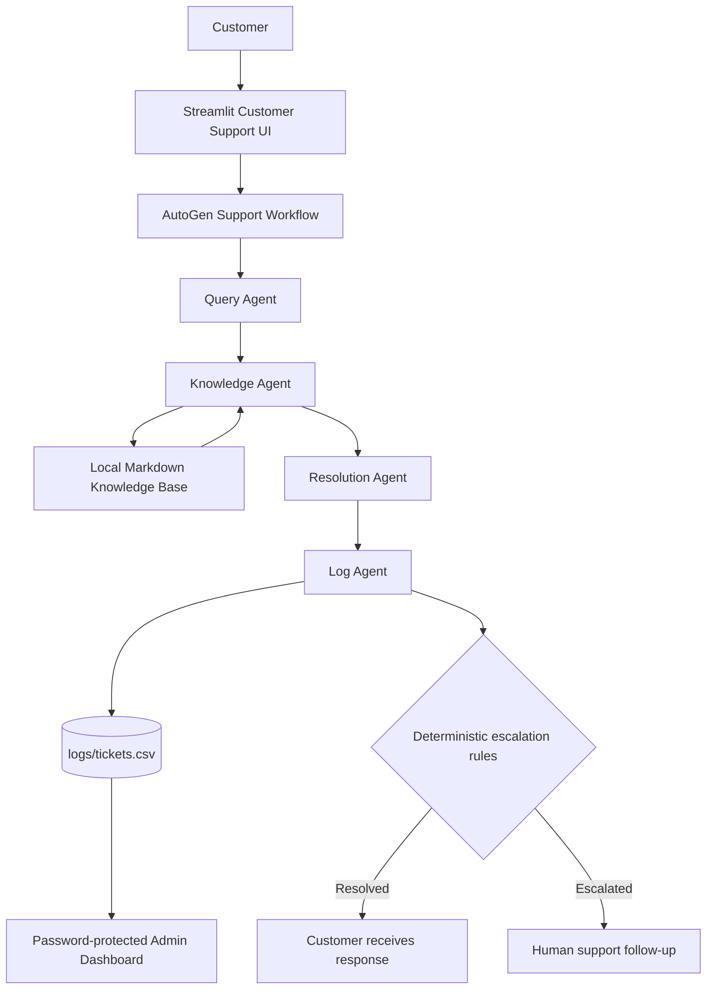

# Kovai Cart AI Customer Support Desk

An AI-powered customer support application built with **Python, AutoGen
0.7.5 and Streamlit**. Kovai Cart helps customers submit order-related
questions, retrieves relevant information from a local Markdown
knowledge base, drafts a grounded response, and records each support
ticket. Requests that meet deterministic escalation rules are marked for
human follow-up.

## Project highlights

-   **Four-agent architecture:** Query, Knowledge, Resolution and Log
    agents have separate responsibilities.
-   **Knowledge-grounded answers:** retrieves relevant passages from
    local Markdown policy and FAQ documents.
-   **Human-in-the-loop escalation:** deterministic rules escalate
    high-risk, angry, unsupported or low-confidence cases.
-   **Ticket logging:** records support requests in a CSV file and
    detects duplicate submissions within a five-minute window.
-   **Customer interface:** Streamlit form with ticket confirmation and
    customer-friendly responses.
-   **Admin dashboard:** password-protected ticket history, metrics,
    filters and CSV export.

## Architecture



The agents operate in the backend. Customers see the final response and
ticket information, not internal agent conversations.

## Agent responsibilities

  -----------------------------------------------------------------------
  Agent                               Responsibility
  ----------------------------------- -----------------------------------
  **Query Agent**                     Classifies the complaint by
                                      category, urgency and sentiment.

  **Knowledge Agent**                 Searches the local Markdown
                                      knowledge base and returns relevant
                                      passages and source filenames.

  **Resolution Agent**                Drafts a customer-facing answer
                                      using retrieved evidence and
                                      reports its confidence.

  **Log Agent**                       Applies escalation rules and
                                      records the ticket in the CSV log.
  -----------------------------------------------------------------------

### Escalation behavior

The logging workflow marks a ticket for escalation when conditions
include:

-   High or unrecognised urgency.
-   Angry customer sentiment.
-   No relevant knowledge-base result.
-   Low or unrecognised response confidence.
-   Legal threats or payment disputes.

Other tickets can be marked `Resolved` when the available evidence and
workflow checks support that outcome. Escalation decisions are made by
deterministic application rules rather than relying only on the model's
wording.

## Knowledge base

The application retrieves information from these local documents:

-   `knowledge_base/shipping_policy.md`
-   `knowledge_base/refund_policy.md`
-   `knowledge_base/account_and_login.md`
-   `knowledge_base/product_faq.md`

The Knowledge Agent uses keyword matching, query expansion and relevance
scoring. Retrieved passages are supplied to the Resolution Agent so that
customer answers can be grounded in the project's documented policies.

If the knowledge base does not contain enough information, the workflow
can escalate the request rather than inventing a policy.

## Technology stack

-   Python
-   AutoGen AgentChat and AutoGen OpenAI extension (tested with AutoGen
    0.7.5)
-   Streamlit
-   OpenAI API (`gpt-4o-mini` configured in `config.py`)
-   Pandas
-   python-dotenv
-   CSV for ticket storage

## Repository structure

``` text
AutogenBuildathon/
├── agents/
│   ├── __init__.py
│   ├── query_agent.py
│   ├── knowledge_agent.py
│   ├── resolution_agent.py
│   └── log_agent.py
├── knowledge_base/
│   ├── shipping_policy.md
│   ├── refund_policy.md
│   ├── account_and_login.md
│   └── product_faq.md
├── screenshots/
│   └── AUtogen_Kovaikart.jpg
├── app.py
├── team.py
├── config.py
├── test_workflow.py
├── test_duplicate_logging.py
├── requirements.txt
├── .env.example
├── .gitignore
└── README.md
```

At runtime, the application creates `logs/tickets.csv`. The `logs/`
directory and `.env` file are excluded from Git so that local ticket
records and secrets are not committed.

## Setup and installation

### 1. Clone the repository

``` bash
git clone https://github.com/shriramk-git/AutogenBuildathon.git
cd AutogenBuildathon
```

### 2. Create and activate a virtual environment

**Windows (Command Prompt):**

``` bat
python -m venv venv
venv\Scripts\activate
```

**Windows (PowerShell):**

``` powershell
python -m venv venv
.\venv\Scripts\Activate.ps1
```

**macOS / Linux:**

``` bash
python3 -m venv venv
source venv/bin/activate
```

### 3. Install dependencies

``` bash
python -m pip install --upgrade pip
pip install -r requirements.txt
```

### 4. Configure environment variables

Copy `.env.example` to a new file named `.env` in the project root.

**Windows Command Prompt:**

``` bat
copy .env.example .env
```

**PowerShell:**

``` powershell
Copy-Item .env.example .env
```

**macOS / Linux:**

``` bash
cp .env.example .env
```

Edit `.env` and provide your own values:

``` env
OPENAI_API_KEY=your_openai_api_key_here
KOVAI_ADMIN_PASSWORD=choose_a_strong_admin_password
```

Do not commit or share `.env`. Never put a real API key or password in
`.env.example`, source code, screenshots or README files.

### 5. Run the application

From the project root, with the virtual environment activated:

``` bash
streamlit run app.py
```

Streamlit will display a local URL in the terminal. Open that URL in
your browser.

## Using the application

### Customer support

1.  Open the **Contact Support** tab.
2.  Enter your name and, if available, your order ID.
3.  Describe the issue and submit the request.
4.  Review the customer-facing response and ticket reference.
5.  If the request needs further attention, the interface explains that
    it has been forwarded to human support.

### Admin ticket history

1.  Open **Admin Ticket History**.
2.  Enter the password configured with `KOVAI_ADMIN_PASSWORD`.
3.  Review ticket metrics and records.
4.  Filter tickets by status and use the CSV download option to export
    ticket history.
5.  Log out when finished.

Admin access is disabled if `KOVAI_ADMIN_PASSWORD` is not configured.
For a hosted deployment, configure the password and API key through the
hosting platform's secret or environment-variable settings rather than
committing them to the repository.

## Ticket logging

Tickets are stored locally in `logs/tickets.csv`. The log includes
fields such as:

-   Ticket ID and timestamp
-   Customer name and order ID
-   Complaint, category, urgency and sentiment
-   Knowledge-base sources
-   Customer-facing response and confidence
-   Ticket status and escalation reason

The Log Agent checks for a matching recent submission and can return the
existing ticket instead of writing a duplicate. The duplicate window is
five minutes. CSV locking protects concurrent operations within a single
application process; it is not a distributed or multi-process locking
system.

**Privacy note:** Ticket logs may contain customer-provided information.
Keep the `logs/` directory private, restrict access to the machine and
exports, and follow your organisation's retention and privacy
requirements.

## Tests

Run the workflow tests from the project root:

``` bash
python test_workflow.py
```

Run the duplicate logging test:

``` bash
python test_duplicate_logging.py
```

The workflow test covers representative cases including a delayed
delivery, damaged product/refund request, unauthorised payment, legal
threat and a question not supported by the knowledge base. The duplicate
test checks that a repeated matching submission returns the existing
ticket rather than creating a second CSV row.

These are local application tests. Results can depend on the configured
model/API access for tests that execute the agents.

## Screenshot


## Configuration notes

-   The model name is configured in `config.py`.
-   The OpenAI API key is read from `.env`.
-   The admin password is read from `KOVAI_ADMIN_PASSWORD`.
-   Ticket CSV files are created under `logs/` at runtime.
-   Knowledge documents are loaded from `knowledge_base/`.

## Limitations and future improvements

-   Knowledge retrieval is a lightweight local keyword-based approach,
    not a vector database.
-   Ticket storage uses a local CSV file and is intended for a single
    application instance, not distributed production workloads.
-   Admin authentication is a simple shared-password gate; production
    deployment should use proper user identity, access control, secure
    secret management and audit controls.
-   Future work could include a persistent database, semantic retrieval,
    order-system integration, authenticated staff accounts and automated
    ticket notifications.

## Author and repository

**GitHub:**
[shriramk-git/AutogenBuildathon](https://github.com/shriramk-git/AutogenBuildathon)
